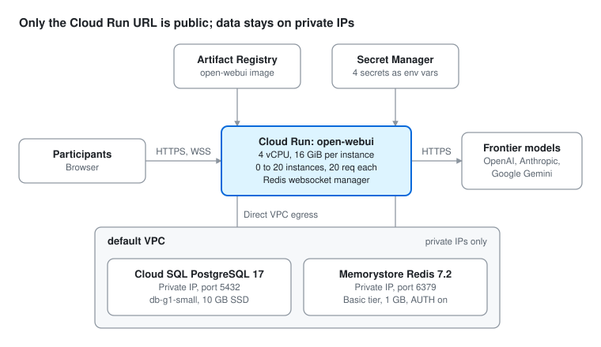

# Side-by-Side LLM UI on Google Cloud — LLM Evaluation Workshop Setup Guide

Nov 6, 2026

Amin Adibi, PhD Student, University of British Columbia

This is the setup we ran for an LLM evaluation workshop with 80 participants in November 2025, and it worked well for us. It ran Open WebUI v0.6 (v0.6.35 to v0.6.39 were the releases that month); menus and setting names may differ in later versions. Treat it as a starting point, not a recipe: experiment with the scaling and instance specs to find the right balance of cost and capability for your event. Values in angle brackets, such as `<PROJECT_ID>`, are placeholders for your own.

**Load-test before the event.** Simulate your expected head count all prompting at once, with side-by-side chats running, and watch instance count, latency and errors. Problems with scaling, connections or provider rate limits are far easier to fix the week before than in front of a room.

## Architecture

Participants get one login where the same prompt goes to several frontier models and the answers appear side by side. One Cloud Run service runs Open WebUI; Postgres stores users, chats and ratings, and Redis shares websocket state across instances.

Only private-IP traffic is routed into the VPC; calls to model APIs leave Cloud Run directly over HTTPS.

## Before you start

You need a project with billing, an account with Owner (or equivalent) rights, and API keys from each model provider you plan to compare.

- Enable the APIs: Cloud Run, Artifact Registry, Cloud SQL Admin, Memorystore for Redis, Secret Manager, Service Networking and Compute Engine.
- Pick one region close to your participants and use it for every service. No GPU is needed, because the models run at the providers.
- Private Service Access needs an allocated IP range on your VPC. The Cloud SQL console offers to create it the first time you choose Private IP; Memorystore then reuses the same connection.
- Size the stack for your head count: the specs below served 80 participants; scale them up or down and test.

## Setup steps

Create every resource in one project and one region, on a single VPC (the `default` network works), with private IPs only. Placeholders used below: `<PROJECT_ID>`, `<REGION>`, `<SQL_INSTANCE>`, `<REDIS_INSTANCE>`, `<SQL_PRIVATE_IP>`, `<REDIS_PRIVATE_IP>` and `<REDIS_AUTH>`. The private IPs and the AUTH string are assigned when each instance is created.

1. **Container image.** Mirror Open WebUI into Artifact Registry as `<REGION>-docker.pkg.dev/<PROJECT_ID>/<REPO>/open-webui:<TAG>`. Pin a release tag before the workshop so a new `main` build can't change the UI mid-session.
2. **Cloud SQL for PostgreSQL 17 (Enterprise).** Instance `<SQL_INSTANCE>`, machine db-g1-small (shared core, 1 vCPU, 1.7 GB), 10 GB SSD with automatic storage increase, single zone.
   - Connections: Private IP via Private Service Access on `default`, Public IP off, private path for Google Cloud services on. Note the internal address it gets (\<SQL\_PRIVATE\_IP>, port 5432).
   - Data protection: daily backups kept 7 days in an off-hours window, point-in-time recovery 7 days, deletion protection on.
   - Create a database and a dedicated user for Open WebUI.
3. **Memorystore for Redis.** Instance `<REDIS_INSTANCE>`, Basic tier, 1 GB, Redis 7.2, Private Service Access on `default`, AUTH enabled. Note the primary endpoint (\<REDIS\_PRIVATE\_IP>, port 6379) and the AUTH string (\<REDIS\_AUTH>). Redis lets several Cloud Run instances share websocket and session state.
4. **Secret Manager.** Create four secrets (automatic replication, Google-managed encryption) and grant the Cloud Run service account `roles/secretmanager.secretAccessor`.

| Secret | Value format |
| --- | --- |
| `DATABASE_URL` | `postgresql://<DB_USER>:<DB_PASSWORD>@<SQL_PRIVATE_IP>:5432/<DB_NAME>`?sslmode=require |
| `REDIS_URL` | `redis://:<REDIS_AUTH>@<REDIS_PRIVATE_IP>:6379/0` |
| `WEBUI_SECRET_KEY` | Random string, e.g. output of `openssl rand -hex 32` |
| `OPENAI_API_KEY` | Provider API key |

5. **Cloud Run service `open-webui`.** Deploy a revision with these settings:

These are the values we used for 80 participants. Memory, CPU, concurrency and instance limits are the main levers for cost versus capacity, so adjust them based on your load test.

| Setting | Value |
| --- | --- |
| Container port | 8080 |
| Memory / CPU | 16 GiB / 4 vCPU |
| Startup probe | TCP 8080, timeout 240 s, failure threshold 1 |
| Request timeout | 3600 s |
| Concurrency | 20 requests per instance |
| Scaling | Min 0, max 20 instances; startup CPU boost on |
| Billing | Instance-based |
| Environment variables | `ENABLE_WEBSOCKET_SUPPORT=True`, `WEBSOCKET_MANAGER=redis` |
| Secrets as env vars | `DATABASE_URL`, `WEBUI_SECRET_KEY`, `OPENAI_API_KEY`, `REDIS_URL` (version `latest`) |
| Cloud SQL connection | `<PROJECT_ID>:<REGION>:<SQL_INSTANCE>` (optional when using the private IP) |
| Networking | Direct VPC egress to the `default` network and subnet; route only private IPs to the VPC |
| Session affinity | On |
| Service account | Compute Engine default, or a dedicated account with Secret Manager access |

Session affinity keeps each browser on one instance, so streamed answers don't break once several instances are running. Cloud Run's local disk lives in memory, so uploaded files and caches count against the memory limit.

6. **First login.** Right after the first deploy, open the service URL and sign up: the URL is public and the first account to sign up becomes admin. Create participant accounts, then set new sign-ups to pending or disable them.

## Frontier models side by side

Open WebUI compares models natively: pick two or more models in the chat's model selector and each prompt is answered by all of them in parallel columns. Add each provider as an OpenAI-compatible connection under **Admin Panel → Settings → Connections**; these are stored in Postgres, so they survive redeploys.

| Provider | OpenAI-compatible base URL | Key |
| --- | --- | --- |
| OpenAI | `https://api.openai.com/v1` | `OPENAI_API_KEY` (already in Secret Manager) |
| Anthropic | `https://api.anthropic.com/v1` | Anthropic API key |
| Google Gemini | `https://generativelanguage.googleapis.com/v1beta/openai` | Gemini API key |

To configure by environment instead, set `OPENAI_API_BASE_URLS` and `OPENAI_API_KEYS` as semicolon-separated lists in matching order; store the joined key list as one secret. A gateway such as OpenRouter or LiteLLM gives one endpoint for many providers if you prefer a single key.

For a fair evaluation:

- Create one workspace model preset per frontier model with the same system prompt, temperature and max tokens.
- Hide raw provider models from participants so they only see the presets.
- Use Arena mode for blind A/B comparison, and have participants rate answers; ratings feed the built-in Evaluations leaderboard.
- Export chats and feedback from the admin panel after each session for analysis.

## Open WebUI admin settings

Side-by-side comparison works with the defaults once the provider connections are added. These are suggestions under **Admin Panel → Settings**:

- **Required on Cloud Run:** turn on *Bypass embedding and retrieval* under Documents and Web Search. Otherwise vectors are stored on each instance's temporary local disk and retrieval breaks across instances. Uploaded files also stay on local disk, so old attachments may not reopen.
- **Recommended:** add a warning banner about sensitive data, turn off autocomplete generation (it calls the model on almost every keystroke), and set upload size and count limits.
- **Optional:** web search (needs a Google Programmable Search Engine key), image generation, code interpreter (runs in the browser), and audio (uses the browser's speech). Title, tag and follow-up generation are extra model calls per chat; point the task model at a small model to cut cost.

## Cost, security and checklist

Model API usage, Cloud Run instance time and Memorystore for Redis were our main costs. Memorystore bills for every hour the instance exists, busy or idle, so create it shortly before the event and delete it afterwards; the create page shows the estimate for your region and size. Redis is only needed when Cloud Run runs more than one instance, so a small event that fits on one instance can skip it. Cloud SQL also runs continuously, while Cloud Run scales to zero between sessions. Set a billing budget alert and spend limits on each provider account.

**Security**

Apply the security settings your organization requires before going live, for example SSL enforcement and a password policy on Cloud SQL, a least-privilege service account, and controlled sign-ups. Keep secrets such as the Redis AUTH string out of screenshots and chats. Secrets exposed as env vars are read at startup, so a new secret version needs a redeploy.

**Pre-workshop checklist**

- [ ] Image tag pinned and revision deployed with 100% traffic
- [ ] Admin account created; participant accounts or invite flow ready
- [ ] All provider connections tested; model presets built and raw models hidden
- [ ] Side-by-side and Arena comparisons tested with two browsers at once (checks Redis websockets across instances)
- [ ] Load-tested at full expected head count, with side-by-side chats and provider rate limits checked; specs and max instances adjusted from the results
- [ ] Budget alert and provider spend limits set
- [ ] Afterwards: export chats and ratings, set max instances to 0, and stop or delete Cloud SQL and Redis (disable deletion protection first)
